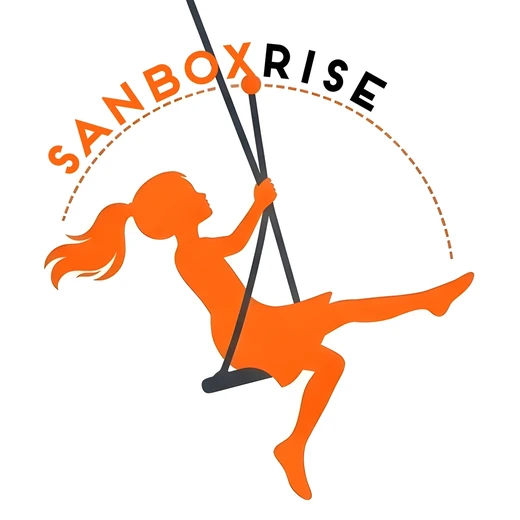

  

<h1 align="center">SandboxRise</h1>

<strong>Where every small idea gets the push to rise.</strong>

Websites · Apps · SEO &amp; digital growth

  <a href="mailto:hello.sandboxrise@gmail.com?subject=Hello%20SandboxRise">Start a conversation</a> ·
  <a href="https://github.com/sandboxrise/SandboxRise">GitHub repository</a> ·
  <a href="https://x.com/SandboxRise">X</a> ·
  <a href="https://www.reddit.com/u/SandboxRise/s/K59H2oWofm">Reddit</a> ·
  <a href="https://pin.it/6AHwgLCAF">Pinterest</a>

---

## Built for the beginning—and what comes next

SandboxRise helps founders and growing teams turn an early idea into a considered digital foundation. We focus on clear scope, useful experiences and steady improvement, rather than promising instant growth or one-size-fits-all outcomes.

### What we help build

- **Websites:** Responsive sites, thoughtful launches and ongoing website Care. Agreed website hosting can be part of a website Care plan; clients arrange their own domains.
- **Apps:** iOS and Android product experiences, from definition to delivery. App backend hosting is quoted and billed **separately** from App Care, typically yearly in advance.
- **SEO & digital growth:** Better foundations for discovery, clearer messaging and measured improvements without guaranteed rankings or invented results.

Our starting point is always the same: understand the idea, agree the scope in writing, build what matters, and keep learning after launch.

## The story behind the swing

Our mark draws on a story of a father and daughter. When a swing rope breaks, the girl falls—but wants to try again. Her father lays sand beneath the swing, supports the rope and gives her another push; they find joy in the second try together. For us, it is a **metaphor for resilience, a stronger foundation and support when an idea needs to rise again**—not real-world advice to use a damaged swing.

## An honest look at this repository

This is the public **SandboxRise GitHub profile**. It contains the profile introduction and licensing notices, not a published client portfolio or the website source. On our own website, publicly launched work may eventually appear only as a small anonymous, non-confidential glimpse, subject to client opt-out or stricter written restrictions. Identifiable details need prior written permission; we will not post even an anonymous client-product glimpse on GitHub or any social channel without separate prior written permission.

The planned website address, `https://sandbox-rise.web.app/`, is **not yet published as a SandboxRise site**; it is not presented here as a deployed service. For a current conversation, email [hello.sandboxrise@gmail.com](mailto:hello.sandboxrise@gmail.com). Email links open a draft that **you must send yourself**.

Interested in working with us? We welcome introductions from people of **any background or career stage**. A message is an invitation to connect, not a promise of a current vacancy.

## Licenses & brand use

The repository's existing [MIT license](LICENSE) is retained for software code. The SandboxRise name, visual identity, girl-on-swing artwork and original brand story are **not open-source assets**; see the [brand rights notice](BRAND-ASSETS.md). The separate website package uses DM Sans and Space Grotesk fonts under their respective [SIL Open Font License 1.1 notices](THIRD_PARTY_NOTICES.md). Those font files and the website source are **not** part of this profile bundle.

See the [license-by-material guide](LICENSES.md) for the exact scope of each notice. No GitHub star or social follow is required to contact us or enquire about paid work; if the planned project thank-you is published, its page/screen bonus likewise is **not** conditional on social engagement.

---

<strong>Start small. Build strong. Rise higher.</strong>

